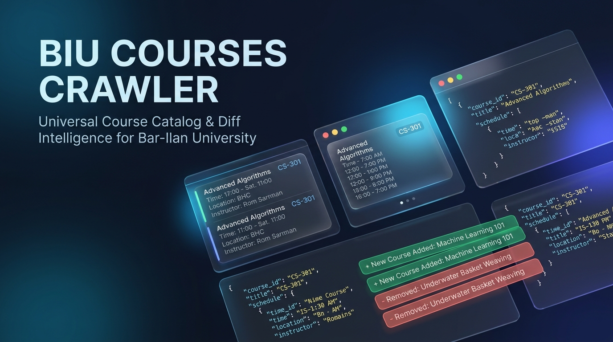
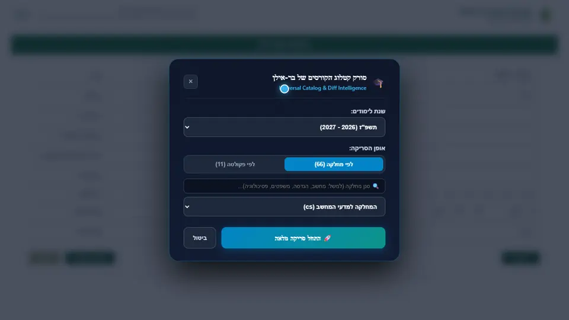
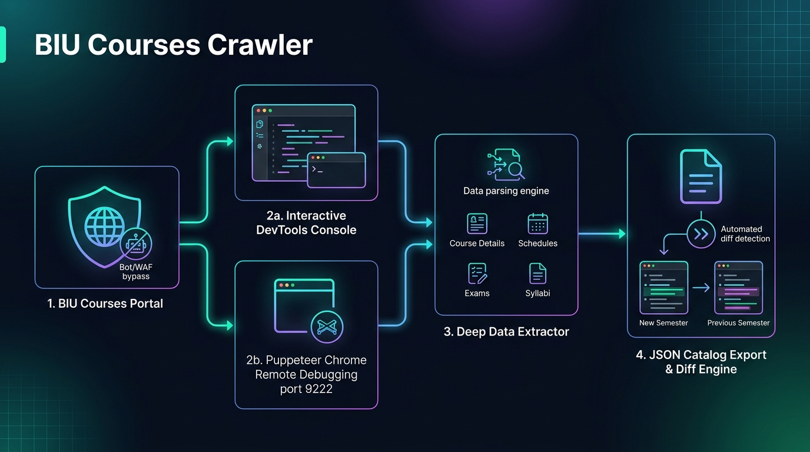
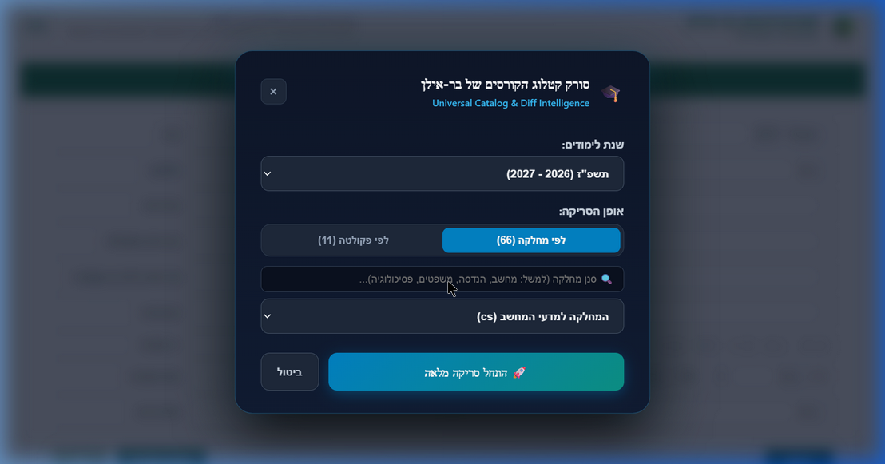
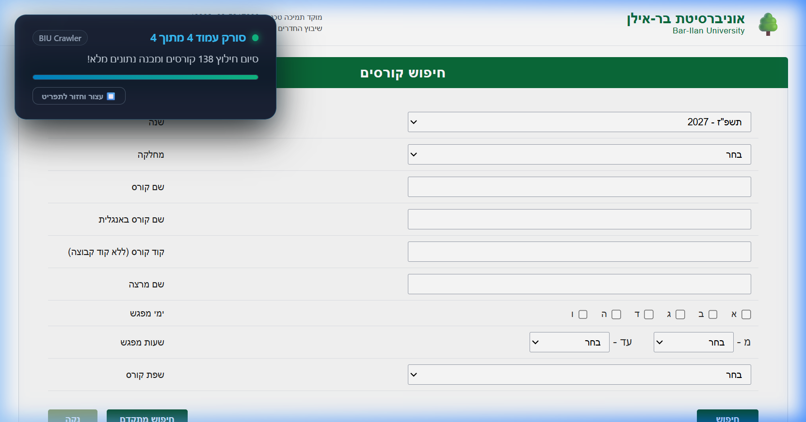
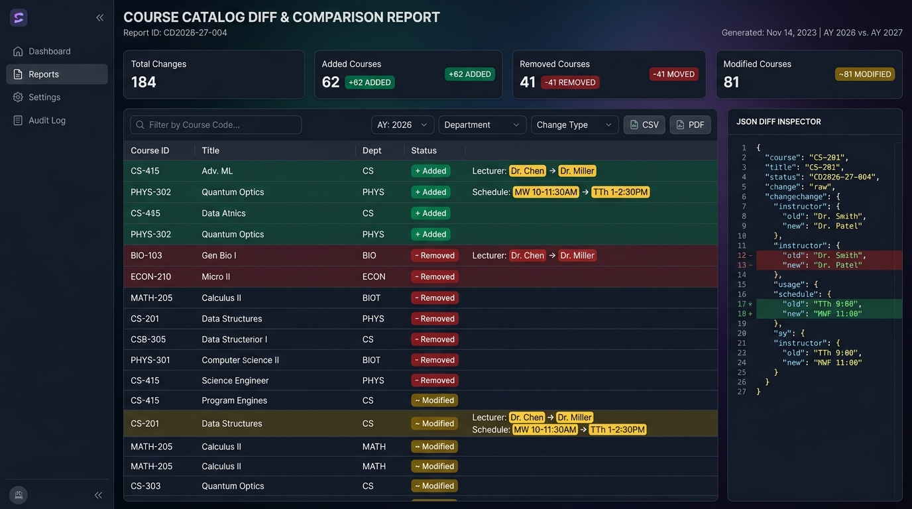

<div align="center">



# 🎓 סורק קטלוג הקורסים של אוניברסיטת בר-אילן
### Universal Bar-Ilan University Course Catalog & Diff Intelligence Engine

[](https://nodejs.org/)
[](https://pptr.dev/)
[](https://courses.biu.ac.il)
[](https://courses.biu.ac.il)
[](./LICENSE)

<br/>

**כלי אוניברסלי, מתקדם ומודרני לחילוץ, ניתוח והשוואת קטלוג הקורסים של כל 11 הפקולטות ו-66 המחלקות באוניברסיטת בר-אילן.**  
המערכת כוללת ממשק צף גרפי יוקרתי הפועל ישירות מעל אתר הקורסים של האוניברסיטה מתוך סשן הדפדפן המחובר שלך, עבודה בקצב מתון (בקשה אחת בכל פעם, לפחות 1.5 שניות בין בקשות), חילוץ עומק של סקשנים, מרצים, כיתות ומועדי בחינות, ומנוע השוואות (Diff Engine) לאיתור שינויים בין סמסטרים.

[🎬 צפה בהדגמת וידאו חיה](#-מדריך-וידאו-אינטראקטיבי) • [🚀 דרכי הרצה](#-דרכי-הרצה) • [📊 מנוע השוואות ושינויים](#-מנוע-השוואת-שינויים-diff-intelligence) • [📁 מבנה נתונים](#-מבנה-הנתונים-המופק-json-schema)

---

</div>

## 📌 תוכן עניינים
- [✨ יתרונות ותכונות עיקריות](#-יתרונות-ותכונות-עיקריות)
- [🎬 מדריך וידאו אינטראקטיבי](#-מדריך-וידאו-אינטראקטיבי)
- [🏛️ ארכיטקטורת המערכת וזרימת הנתונים](#️-ארכיטקטורת-המערכת-וזרימת-הנתונים)
- [🚀 דרכי הרצה](#-דרכי-הרצה)
  - [אפשרות 1: הרצה ישירה ב-Console של הדפדפן (ללא צורך בהתקנה - מומלץ לסטודנטים)](#אפשרות-1-הרצה-ישירה-מתוך-ה-console-של-הדפדפן-ללא-התקנה---מומלץ-לסטודנטים-ולמשתמשי-קצה)
  - [אפשרות 2: הרצה אוטומטית ב-Node.js עם Puppeteer (למפתחים ואוטומציה)](#אפשרות-2-הרצה-אוטומטית-ב-nodejs-עם-puppeteer-port-9222)
- [📊 מנוע השוואת שינויים (Diff Intelligence)](#-מנוע-השוואת-שינויים-diff-intelligence)
- [📁 מבנה הנתונים המופק (JSON Schema)](#-מבנה-הנתונים-המופק-json-schema)
- [🛡️ מדיניות אתיקה, אבטחה וקצב פניות](#️-מדיניות-אתיקה-אבטחה-וקצב-פניות)
- [📚 רשימת פקולטות ומחלקות נתמכות](#-רשימת-פקולטות-ומחלקות-נתמכות)

---

## ✨ יתרונות ותכונות עיקריות

| יכולת | פירוט |
| :--- | :--- |
| **🌐 כיסוי אוניברסלי לכל בר-אילן** | תמיכה מובנית בכל **11 הפקולטות** ו-**66 המחלקות** באוניברסיטה, כולל חיפוש וסינון מהיר בעברית ובאנגלית. |
| **🛡️ עבודה מתוך הסשן שלך, בקצב מתון** | הסורק רץ בתוך סשן הדפדפן שבו כבר נכנסת לאתר, ושולח בקשה אחת בכל פעם עם השהיה של 1.5 שניות לפחות ביניהן. הוא אינו מנסה לעקוף את מנגנוני ההגנה של האוניברסיטה: אם האתר מחזיר CAPTCHA, שגיאת 403/429, דף חסימה או הפניה מחוץ לאתר הקורסים, הסורק עוצר מעצמו ושומר את מה שנאסף. |
| **⚡ הרצה מידית ללא התקנה** | סקריפט עצמאי [`browser-crawl.js`](./browser-crawl.js) עם חלונית צפה בעיצוב Dark Glassmorphism יוקרתי ישירות ב-Console של הדפדפן. |
| **🎯 סריקת עומק מלאה (Deep Crawling)** | חילוץ פרטי סקשנים (הרצאה/תרגול/מעבדה), שמות מרצים ומתרגלים, בניינים וחדרים, מועדי בחינות (מועד א' ו-ב') וסילבוסים. |
| **🔍 מנוע Diff מתקדם (`compare.js`)** | זיהוי אוטומטי של קורסים שנפתחו, בוטלו, או שונו (החלפת מרצים, עדכון שעות כיתה והזזת תאריכי מבחנים). |
| **💾 גיבוי רציף (Checkpoints)** | שמירה תקופתית לדיסק בכל עמוד מונעת איבוד נתונים במקרה של ניתוק רשת זמני. |

---

## 🎬 מדריך וידאו אינטראקטיבי

צפה בסריקה בפעולה: ממשק הסורק המודרני נפתח ישירות מעל אתר הקורסים של אוניברסיטת בר-אילן, מאפשר סינון מהיר של מחלקות, מציג התקדמות בזמן אמת ומוריד את קובץ ה-JSON:

<div align="center">

<video src="./assets/crawler-guide.mp4" poster="./assets/browser-console-ui.png" controls autoplay loop muted playsinline width="100%" style="border-radius: 14px; box-shadow: 0 14px 40px rgba(0,0,0,0.65); max-width: 920px; display: block; margin: 0 auto;">
  
</video>

<br/>


*🎬 הדגמת וידאו מלאה (60fps MP4 / Animated WebP): הפעלת הסורק, סינון מהיר של מחלקת מדעי המחשב, סריקת עמודים רציפה והעתקת JSON*

</div>

---

## 🏛️ ארכיטקטורת המערכת וזרימת הנתונים

המערכת תוכננה בארכיטקטורה היברידית המאפשרת עבודה נוחה ישירות מתוך הדפדפן או כאוטומציה מלאה ב-CLI:

<div align="center">



</div>

### שכבות המערכת:
1. **פורטל הקורסים של בר-אילן (`courses.biu.ac.il`):** האתר הרשמי המוגן על ידי WAF וסינוני בוטים.
2. **שני נתיבי הרצה מקבילים:**
   - **ממשק Console בדפדפן:** רץ ישירות בתוך ה-DOM עם חלונית שליטה ובאנר סטטוס, ללא צורך בהתקנת סביבת פיתוח.
   - **Puppeteer דרך פורט 9222 של Chrome:** מתחבר ל-Chrome קיים ומבצע סריקה אוטומטית שקטה ללא הפרעה.
3. **מנוע חילוץ הנתונים (Deep Data Extractor):** מפרק את ה-HTML ומבצע נרמול למידע היררכי מסודר.
4. **מנוע השוואות ושינויים (Diff Engine):** מנתח שתי סריקות ומפיק דוח שינויים מפורט (`diff-report.json`).

---

## 🚀 דרכי הרצה

### אפשרות 1: הרצה ישירה מתוך ה-Console של הדפדפן (ללא התקנה - מומלץ לסטודנטים ולמשתמשי קצה)

זוהי הדרך הנוחה ביותר שאינה דורשת התקנת Node.js או שום תוכנה נוספת במחשב.

#### 1. חלונית הבחירה מעל אתר הקורסים:
כאשר מדביקים את הסקריפט, נפתחת חלונית שליטה אלגנטית ומודרנית ישירות על גבי האתר:

<div align="center">



</div>

#### שלבי ההפעלה:
1. פתח את אתר הקורסים של בר-אילן בדפדפן: **[https://courses.biu.ac.il](https://courses.biu.ac.il/)**
2. לחץ על **`F12`** במקלדת (או קליק ימני ➔ *Inspect / בדיקה*) ועבור ללשונית **Console**.
3. פתח את הקובץ **[`browser-crawl.js`](./browser-crawl.js)**, העתק את כל הקוד, הדבק ב-Console ולחץ **`Enter`**.

   > ⚠️ **אבטחה:** הדביקו ב-Console רק קוד שקראתם ואתם סומכים עליו, ורק מהמאגר הזה. קוד שמודבק ב-Console רץ עם ההרשאות של החשבון המחובר שלכם.

4. **חלונית הסורק תיפתח במסך:**
   - בחר את שנת הלימודים (ברירת מחדל: **תשפ"ז - 2027**).
   - סנן או בחר מחלקה (לדוגמה: מדעי המחשב, הנדסה, משפטים, פסיכולוגיה).
   - לחץ על **"🚀 התחל סריקה מלאה"**.

#### 2. מעקב התקדמות חי (Live Banner):
במהלך הסריקה יופיע באנר עליון המציג את קצב הסריקה, מספרי הקורסים שנאספו ומד התקדמות מונפש:

<div align="center">



</div>

5. בסיום הסריקה, הקובץ המלא (`biu-2027-<dept>-full-<date>.json`) יירד אוטומטית למחשב שלך.
6. החלונית תציג סיכום עם כפתורי **"📋 העתק JSON"** ו-**"⬇️ שמור קובץ שוב"**.

> [!TIP]
> **רוצה לסרוק חיפוש ידני שכבר ביצעת באתר?**  
> בצע חיפוש רגיל בטופס של בר-אילן. כשתגיע לדף התוצאות (`CoursesView.aspx`), הדבק את הקוד ב-Console — הסורק יזהה מיד את התוצאות שעל המסך ויאפשר לסרוק אותן בלחיצה אחת (`סרוק את התוצאות שמוצגות כעת במסך 🎯`)!

---

### אפשרות 2: הרצה אוטומטית ב-Node.js עם Puppeteer (Port 9222)

מתאים למפתחים, חוקרים, סריקות מתוזמנות וסריקת פקולטות שלמות.

#### 1. התקנת תלויות:
```bash
npm install
```

#### 2. פתיחת Chrome עם פורט Debugging:
סגור את כל חלונות Chrome ופתח חלון חדש עם פורט 9222 פתוח:

**Windows (PowerShell / CMD):**
```cmd
chrome.exe --remote-debugging-port=9222
```

**macOS:**
```bash
/Applications/Google\ Chrome.app/Contents/MacOS/Google\ Chrome --remote-debugging-port=9222
```

**Linux:**
```bash
google-chrome --remote-debugging-port=9222
```

#### 3. כניסה לאתר הקורסים:
גש לכתובת `https://courses.biu.ac.il/`. במידה ומופיע אתגר hCaptcha, פתור אותו פעם אחת באופן ידני.

#### 4. הפעלת הסקריפט:
```bash
# סריקת מחלקה לפי מזהה (לדוגמה: 84 = מדעי המחשב)
node crawl.js --dept 84

# סריקת מחלקה לפי שם בעברית או כינוי (slug) באנגלית
node crawl.js --dept "מדעי המחשב"
node crawl.js --dept cs
node crawl.js --dept math
node crawl.js --dept law

# סריקת פקולטה מלאה (10 = הנדסה, 4 = מדעים מדויקים, 5 = משפטים)
node crawl.js --faculty 10
node crawl.js --faculty "הנדסה"
node crawl.js --faculty exact-sciences

# הגדרת שנת לימודים והשהייה בטוחה בין בקשות (במילישניות)
node crawl.js --dept 84 --year 2027 --delay 1500

# סריקת העמוד שמוצג כרגע בדפדפן (ללא חיפוש חדש)
node crawl.js
```

הקובץ המלא יישמר בשם:  
`biu-<year>-<slug>-full-<YYYY-MM-DD>.json` (לדוגמה: `biu-2027-cs-full-2026-10-15.json`).

---

## 📊 מנוע השוואת שינויים (Diff Intelligence)

מנוע ההשוואה (`compare.js`) מאפשר להשוות בין שני קובצי סריקה של אותה מחלקה או פקולטה ולזהות בדיוק מה השתנה במערכת השעות:

<div align="center">



</div>

### פקודות הרצה:
```bash
# השוואה אוטומטית בין שתי הסריקות האחרונות של אותה מחלקה
npm run compare
# או
node compare.js

# השוואת מחלקה ספציפית
node compare.js cs
node compare.js engineering

# השוואה מפורטת בין שני קבצים ספציפיים
node compare.js biu-2027-cs-full-2026-09-13.json biu-2027-cs-full-2026-10-15.json
```

### מה הדוח מאתר?
- 🟢 **קורסים שנוספו (`+ Added`):** קורסים חדשים שנפתחו לקראת שנת הלימודים.
- 🔴 **קורסים שבוטלו (`- Removed`):** קורסים שהוסרו מהקטלוג הרשמי.
- 🟡 **שינויים ועדכונים (`~ Modified`):**
  - החלפת מרצים, מתרגלים או ראשי קבוצות.
  - שינוי שעות הרצאה, ימי לימוד ומיקומי כיתות/בניינים.
  - עדכוני תאריכי בחינות (מועד א' ומועד ב').
  - שינויי נקודות זכות (נ"ז) או סוג המפגש.

דוח השינויים המלא נשמר בקובץ המובנה `diff-report.json`.

---

## 📁 מבנה הנתונים המופק (JSON Schema)

המידע מחולץ למבנה נקי, היררכי ונוח לשימוש באפליקציות, בניית מערכות שעות ואנליזה:

```json
{
  "metadata": {
    "crawledAt": "2026-10-15T11:30:00.000Z",
    "year": "2027",
    "department": {
      "id": "84",
      "name": "המחלקה למדעי המחשב",
      "slug": "cs"
    },
    "totalCourses": 138
  },
  "courses": [
    {
      "courseId": "89-201-01",
      "name": "מבני נתונים ואלגוריתמים",
      "englishName": "Data Structures and Algorithms",
      "credits": 4.0,
      "semester": "סמסטר א'",
      "syllabusUrl": "https://courses.biu.ac.il/CourseSylabusView.aspx?lid=12345",
      "sections": [
        {
          "sectionNumber": "01",
          "type": "הרצאה",
          "lecturer": "פרופ' אברהם ישראלי",
          "schedule": [
            {
              "day": "ג'",
              "startTime": "10:00",
              "endTime": "12:00",
              "building": "בניין 604",
              "room": "חדר 101",
              "location": "בניין 604 / חדר 101"
            }
          ]
        }
      ],
      "exams": {
        "moedA": { "date": "2027-02-15", "day": "ב'", "time": "09:00" },
        "moedB": { "date": "2027-03-20", "day": "ה'", "time": "09:00" }
      }
    }
  ]
}
```

---

## 🛡️ מדיניות אתיקה, אבטחה וקצב פניות

- **השהיית בטיחות מובנית:** כברירת מחדל, הסורק משהה כל בקשה ב-`1,500 מ"ש` (`--delay 1500`) כדי לשמור על יציבות שרתי האוניברסיטה ולא להעמיס עליהם. הבקשות נשלחות אחת אחרי השנייה, לא במקביל.
- **עצירה אוטומטית בחסימה:** אחרי כל בקשה וכל טעינת עמוד, הסורק בודק אם האתר החזיר שגיאת 403/429, דף CAPTCHA (hCaptcha), דף אימות של Radware, דף חסימה, או הפנה אל מחוץ ל-`courses.biu.ac.il`. במקרה כזה הוא עוצר מיד, שומר את מה שנאסף עד אותו רגע (בגרסת ה-CLI לקובץ `checkpoint-<slug>.json` ויוצא עם קוד 2; בגרסת הדפדפן כקובץ `biu-...-partial-....json` שיורד למחשב) ומציג הודעה בעברית. הסורק אינו מנסה שוב ואינו מנסה לעקוף את החסימה — וגם אתם לא צריכים: אל תריצו אותו שוב מיד.
- **סריקה לקריאה בלבד:** הסקריפט אינו מבצע רישום לקורסים, שינוי נתונים או שליחת טפסים מעבר לחיפוש רגיל — הוא מחלץ נתונים ציבוריים בלבד.
- **שמירת ביקורת (Checkpoints):** מנגנון שמירה אוטומטי שומר את הנתונים אחת למספר עמודים בקובץ `checkpoint-<slug>.json`, כך שבמקרה של ניתוק רשת לא צריך לסרוק שוב מההתחלה.

---

## 📚 רשימת פקולטות ומחלקות נתמכות

כדי לראות את כל 11 הפקולטות ו-66 המחלקות עם המזהים (IDs) והכינויים שלהן:

```bash
node crawl.js --list
# או
npm run crawl:list
```

### טבלת פקולטות עיקריות לדוגמה:
| מזהה (ID) | שם הפקולטה | כינוי באנגלית (Slug) |
| :---: | :--- | :--- |
| **10** | הפקולטה להנדסה ע"ש אלכסנדר קופקין | `engineering` |
| **4** | הפקולטה למדעים מדויקים | `exact-sciences` |
| **5** | הפקולטה למשפטים | `law` |
| **8** | הפקולטה למדעי החיים ע"ש מינה ואבררד גודמן | `life-sciences` |
| **3** | הפקולטה למדעי החברה | `social-sciences` |
| **9** | הפקולטה לרפואה | `medicine` |
| **2** | הפקולטה למדעי הרוח | `humanities` |
| **1** | הפקולטה למדעי היהדות | `jewish-studies` |
| **12** | הפקולטה לחינוך ע"ש פנחס חורגין | `education` |

---

<div align="center">

**BIU Course Catalog Crawler** • נבנה באהבה עבור סטודנטים, חוקרים ומפתחים באוניברסיטת בר-אילן 🎓  
מצאת את הכלי שימושי? נשמח ל-⭐ ב-GitHub!

</div>
